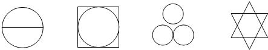

# Mathematics (Grade 2)

**ID**: b34373f1
**难度**: medium_hard
**题型**: multiple_choice

## 题目
以下四组图形都是轴对称图形，它们的对称轴共有（  ）条．

$\begin{description}
\item A．11条\item B．13条\item C．15条\item D．无数条
\end{description}$

## 解答

**答案**: B

1. Step1:分析第一个图形，其有2条对称轴
2. Step2:分析第二个图形，其有4条对称轴
3. Step3:分析第三个图形，其有1条对称轴
4. Step4:分析第四个图形，其有6条对称轴
5. Step5:将四个图形的对称轴数量相加，2 + 4 + 1 + 6 = 13条
6. Step6:得出答案为13条对称轴，对应选项B

## 知识点

**知识点**:
  - 确定轴对称图形的对称轴条数及位置．

---
