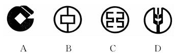

# Mathematics (Grade 2)

**ID**: b9c2f8ce
**难度**: medium_hard
**题型**: multiple_choice

## 题目
下面的图形是几家银行的标志，其中（）不是轴对称图形。

## 解答

**答案**: A

1. Step1:明确轴对称图形的定义为如果一个图形沿着一条直线对折后两部分完全重合，这样的图形叫做轴对称图形
2. Step2:判断选项A，发现找不到一条直线使该图形对折后两部分完全重合，所以A不是轴对称图形
3. Step3:判断选项B，能找到一条直线使图形对折后两部分完全重合，所以B是轴对称图形
4. Step4:判断选项C，能找到一条直线使图形对折后两部分完全重合，所以C是轴对称图形
5. Step5:判断选项D，能找到一条直线使图形对折后两部分完全重合，所以D是轴对称图形
6. Step6:根据题目要求找出不是轴对称图形的选项，确定答案为A

## 知识点

**知识点**:
  - 画轴对称图形的对称轴

---
