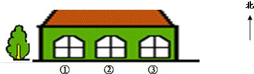

# Mathematics (Grade 2)

**ID**: bca23ef6
**难度**: medium_hard
**题型**: multiple_choice

## 题目
聪聪、明明和静静住在相邻的三个房间里．聪聪住在明明的东面，静静与聪聪不相邻，你知道静静住在(  )个房间．

A．①
B．②
C．③
D．不能判断

## 解答

**答案**: A

1. Step1:已知聪聪、明明和静静住在相邻的三个房间里，且静静与聪聪不相邻，由此可推出明明住在中间的房间，即②号房
2. Step2:因为聪聪住在明明的东面，所以③号房是聪聪的房间
3. Step3:三个房间中②号房是明明的，③号房是聪聪的，那么剩下的①号房就是静静住的房间，所以答案是A

## 知识点

**知识点**:
  - 逻辑推理．

---
