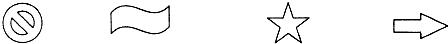

# Mathematics (Grade 2)

**ID**: be8e4fb1
**难度**: medium_hard
**题型**: multiple_choice

## 题目
在下列图形中，有（  ）个是轴对称图形．

A．1
B．3
C．2
D．4

## 解答

**答案**: B

1. Step1:明确轴对称图形的定义为如果一个图形沿着一条直线对折后两部分完全重合，这样的图形叫做轴对称图形，这条直线叫做对称轴。
2. Step2:对从左数第一个图形进行判断，根据定义可知其是轴对称图形。
3. Step3:对从左数第二个图形进行判断，根据定义可知其不是轴对称图形。
4. Step4:对从左数第三个图形进行判断，根据定义可知其是轴对称图形。
5. Step5:对从左数第四个图形进行判断，根据定义可知其是轴对称图形。
6. Step6:统计是轴对称图形的个数为3个，得出答案为B。

## 知识点

**知识点**:
  - 轴对称图形的辨识．

---
