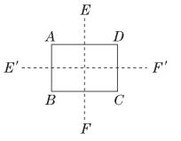

# Mathematics (Grade 2)

**ID**: d311adee
**难度**: medium_hard
**题型**: multiple_choice

## 题目
判断：直线EF和E′F′是长方形ABCD的对称轴。如果点A到对称轴EF的距离是3cm。那么点B到对称轴E′F′的距离也是3cm。（）

## 解答

**答案**: ×

1. Step1:根据轴对称的定义和性质，A与D关于对称轴EF对称，所以点D到对称轴EF的距离与A到对称轴EF的距离相等，为3厘米
2. Step2:因为A与B关于对称轴E′F′对称，所以点B到对称轴E′F′的距离与A到对称轴E′F′的距离相等
3. Step3:由前面步骤可知点B到对称轴E′F′的距离与A到对称轴E′F′的距离相等，但不一定为3厘米，所以该说法错误

## 知识点

**知识点**:
  - 初步认识轴对称图形

---
