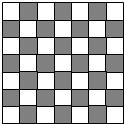

# Mathematics (Grade 2)

**ID**: e5f699cd
**难度**: medium_hard
**题型**: multiple_choice

## 题目
如图所示的7×7的方格内，有许多边长为整数的正方形，其中在有的正方形中黑方格与白方格的个数占一半（同样多）．像这样的正方形有（  ）个．
A．26
B．36
C．46
D．56
E．66

## 解答

**答案**: D

1. Step1:观察图形，确定黑方格与白方格个数各占一半的正方形边长为2、4、6
2. Step2:计算边长为2的2×2正方形个数，每行有6个，每列有6个，共6×6 = 36个
3. Step3:计算边长为4的4×4正方形个数，每行有4个，每列有4个，共4×4 = 16个
4. Step4:计算边长为6的6×6正方形个数，每行有2个，每列有2个，共2×2 = 4个
5. Step5:将上述三种正方形个数相加，36 + 16 + 4 = 56个

## 知识点

**知识点**:
  - 组合图形的计数．

---
