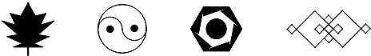

# Mathematics (Grade 2)

**ID**: f51a1bb0
**难度**: medium_hard
**题型**: multiple_choice

## 题目
下列图案是轴对称图形的有（ ）个．

$\begin{description}
\item A．1\item B．2\item C．3
\end{description}$

## 解答

**答案**: B

1. Step1:明确判断依据为轴对称图形的概念
2. Step2:判断第一个图形，得出是轴对称图形
3. Step3:判断第二个图形，得出不是轴对称图形
4. Step4:判断第三个图形，得出不是轴对称图形
5. Step5:判断第四个图形，得出是轴对称图形
6. Step6:统计轴对称图形个数为2个，确定答案为B

## 知识点

**知识点**:
  - 

---
