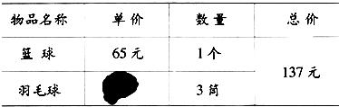

# Mathematics (Grade 2)

**ID**: 2bacd30e
**难度**: medium_hard
**题型**: short_answer

## 题目
体育老师不小心把购货发票弄脏了，你能帮他算出羽毛球每筒多少元吗？

## 解答

**答案**: 24

1. Step1:明确已知条件，体育老师买1个篮球和3筒羽毛球总共花费137元，篮球单价为65元
2. Step2:计算买3筒羽毛球花费的金额，用总花费137元减去买篮球的65元，即137 - 65 = 72元
3. Step3:计算每筒羽毛球的单价，因为3筒羽毛球花费72元，所以用72除以3，即72÷3 = 24元

## 知识点

**知识点**:
  - 整数、小数复合应用题．

---
