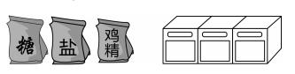

# Mathematics (Grade 2)

**ID**: 2e541399
**难度**: medium_hard
**题型**: short_answer

## 题目
把下面三种调味品装入右边的调料盒，有几种不同的装法。

## 解答

**答案**: 6

1. Step1:确定第一个调料盒的装法，因为有三种调味品，所以第一个调料盒有3种装法
2. Step2:确定第二个调料盒的装法，当第一个调料盒装了一种调味品后，还剩下两种调味品，所以第二个调料盒有2种装法
3. Step3:确定第三个调料盒的装法，当第一、二个调料盒装完后，只剩下1种调味品，所以第三个调料盒有1种装法
4. Step4:根据排列组合的乘法原理，将每个调料盒的装法数相乘，即3×2×1 = 6种装法

## 知识点

**知识点**:
  - 乘法原理（排列组合）(奥数)

---
