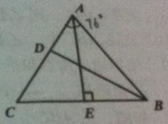

# Mathematics (Grade 2)

**ID**: 3014d98c
**难度**: medium_hard
**题型**: short_answer

## 题目
如图，在△ABC中， BD是∠ABC的角平分线， AE是BC边上的高，且∠CAB＝76°， ∠CDB＝107°，试求∠EAC的大小．

## 解答

**答案**: 48°

1. Step1:根据三角形外角性质，在△ABD中，因为∠CDB是外角，∠CAB和∠ABD是不相邻内角，所以∠ABD = ∠CDB - ∠CAB = 107° - 76° = 31°
2. Step2:由于BD是∠ABC的角平分线，所以∠ABC = 2×∠ABD = 2×31° = 62°
3. Step3:因为AE是BC边上的高，在Rt△ABE中，根据直角三角形两锐角和为90°，可得∠BAE = 90° - ∠ABC = 90° - 62° = 28°
4. Step4:已知∠CAB = 76°，所以∠EAC = ∠CAB - ∠BAE = 76° - 28° = 48°

## 知识点

**知识点**:
  - 

---
