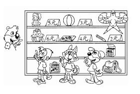

# Mathematics (Grade 2)

**ID**: 31a47710
**难度**: medium_hard
**题型**: short_answer

## 题目
小小超市。

（1）买4支铅笔需要多少钱？
（2）12元钱可以买几个皮球？
（3）25元钱可以买几个布娃娃？

## 解答

**答案**: 8, 4, 5

1. Step1:已知一支铅笔2元，求买4支铅笔的钱数，根据乘法意义，用单价乘以数量，即2×4 = 8元
2. Step2:已知1个皮球3元，求12元能买几个皮球，根据包含除法意义，用总钱数除以单价，即12÷3 = 4个
3. Step3:已知一个布娃娃5元，求25元能买几个布娃娃，根据包含除法意义，用总钱数除以单价，即25÷5 = 5个

## 知识点

**知识点**:
  - 乘法口诀;用口诀求商

---
