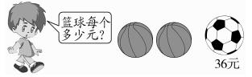

# Mathematics (Grade 2)

**ID**: 45cdfc72
**难度**: medium_hard
**题型**: short_answer

## 题目
解决问题。
张老师花126元钱买了2个篮球和1个足球。

## 解答

**答案**: 45

1. Step1:根据题目可知总钱数是126元，一个足球价格是36元，且总钱数=一个足球价格+两个篮球的价格，所以用总钱数126元减去一个足球的价格36元，得到两个篮球的价格，即126 - 36 = 90元。
2. Step2:因为两个篮球的价格是90元，根据除法的意义，用两个篮球的价格90元除以2，得到每个篮球的价格，即90÷2 = 45元。

## 知识点

**知识点**:
  - 整数复合应用题

---
