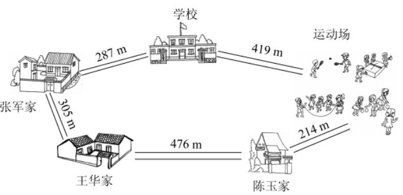

# Mathematics (Grade 2)

**ID**: 5694a190
**难度**: medium_hard
**题型**: short_answer

## 题目
看图回答问题。

张军从家到运动场有几条路可以走？各应走多少米？

## 解答

**答案**: 706, 995

1. Step1:观察图可知从张军家到运动场有两条路可走，第一条路是经过学校再到运动场，第二条路是经过王华和陈玉家再到运动场
2. Step2:计算第一条路的长度，用张军家到学校的距离287米加上学校到运动场的距离419米，即287 + 419 = 706米
3. Step3:计算第二条路的长度，用张军家到王华家的距离305米加上王华家到陈玉家的距离476米，再加上陈玉家到运动场的距离214米，即305 + 476 + 214 = 995米

## 知识点

**知识点**:
  - 万以内数的加减法

---
