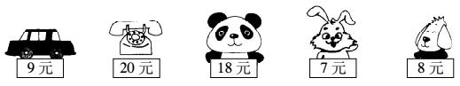

# Mathematics (Grade 2)

**ID**: 6dae79d9
**难度**: medium_hard
**题型**: short_answer

## 题目
玩具商店。

（1）买1辆玩具汽车和1只玩具熊猫，需要多少钱？
（2）小丽买了4只玩具狗和1部玩具电话，共需要多少钱？
（3）请你再提出一个用乘法解决的问题并解答。

## 解答

**答案**: 27, 52, 15

1. Step1:由图可知玩具汽车单价9元，玩具熊猫单价18元，根据加法意义，将两者单价相加，即9 + 18 = 27元，得出买1辆玩具汽车和1只玩具熊猫需要27元
2. Step2:由图可知玩具狗单价8元，玩具电话单价20元，根据乘法意义先求出4只玩具狗价钱为8×4 = 32元，再与玩具电话单价相加，即32 + 20 = 52元，得出小丽买4只玩具狗和1部玩具电话共需要52元
3. Step3:提出问题“一只玩具兔子和一只玩具狗需要多少钱”，由图可知玩具兔子单价7元，玩具狗单价8元，根据加法意义将两者单价相加，即7 + 8 = 15元，得出一只玩具兔子和一只玩具狗需要15元

## 知识点

**知识点**:
  - 整数的乘（除）加、减的两步混合运算;100以内数的进位加法和退位减法

---
