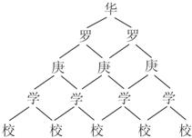

# Mathematics (Grade 2)

**ID**: 7bfb519a
**难度**: medium_hard
**题型**: short_answer

## 题目
在图中，从“华”字开始，每次向下移到一个相邻的字可以读书“化罗庚学校”．那么共有多少种不同的读法？

## 解答

**答案**: 120

1. Step1:确定第一个字是“华”，此时只有1种选择
2. Step2:从“华”字向下相邻的字有“罗”“罗”，共2个，所以第二个字有2种选择
3. Step3:从第二个字向下相邻的字有3个“庚”，所以第三个字有3种选择
4. Step4:从第三个字向下相邻的字有4个“学”，所以第四个字有4种选择
5. Step5:从第四个字向下相邻的字有5个“校”，所以第五个字有5种选择
6. Step6:根据乘法原理，将每个步骤的选择数相乘，即1×2×3×4×5=120种不同读法

## 知识点

**知识点**:
  - 排列组合．

---
