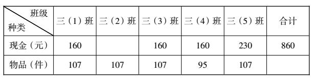

# Mathematics (Grade 2)

**ID**: 8485aed3
**难度**: medium_hard
**题型**: short_answer

## 题目
下表是三年级同学在为灾区小朋友献爱心活动中收集到的捐款及物品情况。

（1）三（2）班同学共捐了多少元钱？
（2）三年级同学共捐了多少件物品？

## 解答

**答案**: 150, 523

1. Step1:计算三（2）班捐款数，先算出160×3 = 480，再算860 - 230 = 630，最后630 - 480 = 150元
2. Step2:计算三年级同学捐物品总数，先算出107×4 = 428，再算428 + 95 = 523件

## 知识点

**知识点**:
  - 整数的乘（除）加、减的两步混合运算

---
