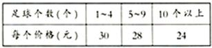

# Mathematics (Grade 2)

**ID**: a22eeaaa
**难度**: medium_hard
**题型**: short_answer

## 题目
为了激励中国足球冲击世界杯．爱国体育用品商店开展足球促销活动：

720元钱最多能买多少个足球？

## 解答

**答案**: 30

1. Step1:分析题目可知，需要根据总价和不同购买数量对应的单价来确定能买足球的数量
2. Step2:判断720元按照不同价格所能购买足球的数量范围，720÷30 = 24个，720÷28 ≈ 25.7个，720÷24 = 30个，可知720元能买10个以上足球
3. Step3:因为能买10个以上足球，所以单价为24元
4. Step4:根据公式“总价÷单价=数量”，用720除以24，即720÷24 = 30个，得出最多能买足球的数量为30个

## 知识点

**知识点**:
  - 整数、小数复合应用题．

---
