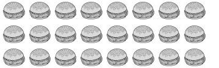

# Mathematics (Grade 2)

**ID**: ae521c72
**难度**: medium_hard
**题型**: short_answer

## 题目
分汉堡。

（1）把这些汉堡平均分给7个小朋友，每个小朋友分几个，还剩几个？
（2）如果每5个汉堡装一袋，一共可以装几袋，还剩几个汉堡？

## 解答

**答案**: 3（个）……3（个）, 4（袋）……4（个）

1. Step1:数出图中汉堡的总数为24个
2. Step2:计算把24个汉堡平均分给7个小朋友时，24÷7=3（个）……3（个），得到每个小朋友分3个，还剩3个
3. Step3:计算每5个汉堡装一袋时，24÷5=4（袋）……4（个），得到一共可以装4袋，还剩4个汉堡

## 知识点

**知识点**:
  - 表内有余数除法

---
