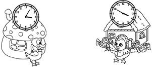

# Mathematics (Grade 2)

**ID**: 4a88b559
**难度**: medium
**题型**: multiple_choice

## 题目
小鸭从家里出发,到小鸡家去做客,路上用了(  )分钟。

$\begin{description}
\item A．55\item B．50\item C．45
\end{description}$

## 解答

**答案**: C

1. Step1:观察第一个时钟，时针指向1和2之间，分针指向2，可知此时时间是1时10分，这是小鸭出发的时间。
2. Step2:观察第二个时钟，时针指向1和2之间，分针指向11，可知此时时间是1时55分，这是小鸭到达小鸡家的时间。
3. Step3:用到达时间1时55分减去出发时间1时10分，即55 - 10 = 45（分钟），得出路上所用时间为45分钟，所以答案选C。

## 知识点

**知识点**:
  - 小学数学;数与代数;常见的量;时间单位及换算;经过时间的计算

---
