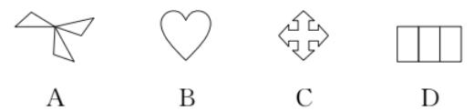

# Mathematics (Grade 2)

**ID**: 6678e553
**难度**: medium
**题型**: multiple_choice

## 题目
下图中既能通过旋转，又能通过轴对称变换得到的图形是（）

## 解答

**答案**: C

1. Step1:明确题目要求，需要找出既能通过旋转，又能通过轴对称变换得到的图形。
2. Step2:分析选项A，根据旋转和轴对称的定义，A中的图形只能由旋转得到，不能由轴对称得到，所以A不符合要求。
3. Step3:选项B未给出相关分析，但可暂不考虑其具体情况，继续分析其他选项。
4. Step4:分析选项C，由旋转和轴对称的知识可知，C可以通过旋转和轴对称得到，符合题目要求。
5. Step5:选项D未提及相关性质，且前面已找到符合要求的C选项，所以确定答案为C。

## 知识点

**知识点**:
  - 运用平移、对称和旋转设计图案

---
