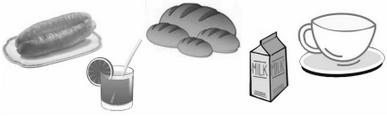

# Mathematics (Grade 2)

**ID**: 72d10458
**难度**: medium
**题型**: multiple_choice

## 题目
选一选：饮料和点心只能各选一种，早餐有多少种搭配方法？

## 解答

**答案**: 6

1. Step1:明确有3种饮料和2种点心
2. Step2:根据乘法原理，从3种饮料中选一种有3种选法
3. Step3:从2种点心中选一种有2种选法
4. Step4:用饮料的选择数量3乘以点心的选择数量2，即3×2
5. Step5:计算得出3×2=6，得到早餐搭配的不同种的数量为6种

## 知识点

**知识点**:
  - 搭配中的学问;乘法原理（排列组合）(奥数)

---
