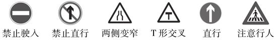

# Mathematics (Grade 2)

**ID**: 7a13cb82
**难度**: medium
**题型**: multiple_choice

## 题目
每年的12月2日是全国交通安全日。下列交通标志中，是轴对称图形的有(  )。

$\begin{description}
\item A．2个\item B．3个\item C．4个
\end{description}$

## 解答

**答案**: C

1. Step1:明确轴对称图形的定义，即如果一个图形沿着一条直线对折后两部分完全重合，这样的图形叫做轴对称图形。
2. Step2:依次分析各个交通标志。第一个禁止驶入标志，沿着中间竖线对折后两部分完全重合，是轴对称图形。
3. Step3:第二个禁止直行标志，沿着中间竖线对折后两部分完全重合，是轴对称图形。
4. Step4:第三个两侧变窄标志，沿着中间竖线对折后两部分完全重合，是轴对称图形。
5. Step5:第四个T形交叉标志，无论沿哪条直线对折，两部分都不能完全重合，不是轴对称图形。
6. Step6:第五个直行标志，沿着中间竖线对折后两部分完全重合，是轴对称图形。
7. Step7:第六个注意行人标志，无论沿哪条直线对折，两部分都不能完全重合，不是轴对称图形。
8. Step8:统计轴对称图形的个数为4个，所以答案选C。

## 知识点

**知识点**:
  - 

---
