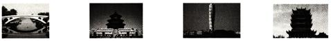

# Mathematics (Grade 2)

**ID**: 7ad30845
**难度**: medium
**题型**: multiple_choice

## 题目
下面建筑物中，（   ）的外形是不对称的。

$\begin{description}
\item A．赵州桥\item B．祈年殿\item C．马尔默旋转大厦\item D．黄鹤楼
\end{description}$

## 解答

**答案**: C

1. Step1:分析选项A，赵州桥整体造型是对称的
2. Step2:分析选项B，祈年殿外观是对称的
3. Step3:分析选项C，马尔默旋转大厦因其独特的旋转造型，外形不对称
4. Step4:分析选项D，黄鹤楼外观是对称的
5. Step5:得出结论，外形不对称的是马尔默旋转大厦，即选项C

## 知识点

**知识点**:
  - 小学数学;图形与几何;图形与变换;轴对称的认识及辨认

---
