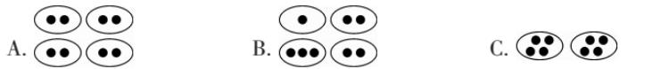

# Mathematics (Grade 2)

**ID**: 851e5124
**难度**: medium
**题型**: multiple_choice

## 题目
把8个●平均分成4份，哪种分法对？（）

## 解答

**答案**: A

1. Step1:明确题目要求是把8个●平均分成4份
2. Step2:根据平均分的意义，确定用除法计算，列出算式8÷4
3. Step3:依据乘法口诀二四得八，计算得出8÷4 = 2（个）
4. Step4:观察选项，发现A选项每份是2个，符合计算结果

## 知识点

**知识点**:
  - 用口诀求商;除法的认识;乘法口诀

---
