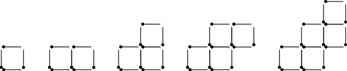

# Mathematics (Grade 2)

**ID**: 9b84acbd
**难度**: medium
**题型**: multiple_choice

## 题目
用火柴按照如图的方法摆正方形(每条边摆1根火柴),照这样,摆15个正方形共需要(  )根火柴。

A．45
B．46
C．55
D．60

## 解答

**答案**: B

1. Step1:分析摆正方形所需火柴规律，摆1个正方形需要4根火柴，可写成3×1 + 1；摆2个正方形需要7根火柴，可写成3×2 + 1；摆3个正方形需要10根火柴，可写成3×3 + 1；以此类推，摆n个正方形需要火柴数的表达式为3n + 1。
2. Step2:题目要求摆15个正方形，将n = 15代入上述表达式3n + 1，即3×15 + 1。
3. Step3:计算3×15 + 1 = 45 + 1 = 46。
4. Step4:得出摆15个正方形共需要46根火柴，答案选B。

## 知识点

**知识点**:
  - 小学数学;数与代数;应用题;常见的数学问题;数与形

---
