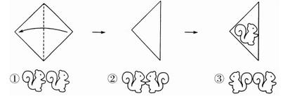

# Mathematics (Grade 2)

**ID**: 9d16434d
**难度**: medium
**题型**: multiple_choice

## 题目
按照下面的剪法，剪出来的图形是（）。

## 解答

**答案**: ②

1. Step1:观察题目中的剪法，可知是将图形进行折叠后再剪；
2. Step2:根据解析，明确剪出来的图形是轴对称图形；
3. Step3:观察所给选项，判断哪个图形是轴对称图形，选项②是轴对称图形，符合要求

## 知识点

**知识点**:
  - 轴对称

---
