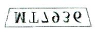

# Mathematics (Grade 2)

**ID**: ab316b48
**难度**: medium
**题型**: multiple_choice

## 题目
一辆汽车的车牌在水中的倒影如图所示，则该车车牌的号码是（  ）。
 
A．MT7936
B．WT6397
C．WT7936

## 解答

**答案**: A

1. Step1:根据镜面对称的性质，水中倒影与实际车牌是关于水平直线成轴对称的关系。
2. Step2:观察水中倒影的字符形状，将其沿水平直线翻转还原。
3. Step3:倒影中最左边的字符翻转后是'M'，第二个字符翻转后是'T'，第三个字符翻转后是'7'，第四个字符翻转后是'9'，第五个字符翻转后是'3'，第六个字符翻转后是'6'。
4. Step4:得出实际车牌号码是MT7936，所以答案选A。

## 知识点

**知识点**:
  - 小学数学;图形与几何;图形与变换;镜面对称

---
