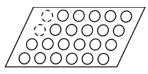

# Mathematics (Grade 2)

**ID**: 10fc703e
**难度**: medium
**题型**: short_answer

## 题目
如图，一板药片已经吃了2颗，这板药片还有多少颗？（列式解答）

答：这板药片还有（   ）颗。

## 解答

**答案**: 22

1. Step1:观察图片可知，这板药片排列成近似长方形，横向每行有6颗，纵向每列有4颗，所以药片总数为4×6 = 24颗
2. Step2:已知已经吃了2颗
3. Step3:用总数减去吃掉的数量，即24 - 2 = 22颗，得到剩余药片数量

## 知识点

**知识点**:
  - 小学数学;数与代数;应用题;简单应用题;整数简单应用题

---
