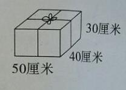

# Mathematics (Grade 2)

**ID**: 34ae7d00
**难度**: medium
**题型**: short_answer

## 题目
小波想用彩带按下面的方式把礼品盒捆扎起来，如果打结处用33厘米长的彩带，那么他最少需要准备多长的彩带？

 30厘米  40厘米  50厘米

## 解答

**答案**: 273厘米

1. Step1:分析可知，彩带的长度由长方体两个长、两个宽、两个高以及打结处的长度组成
2. Step2:先计算长方体两个长、两个宽、两个高的长度之和，长为50厘米，宽为40厘米，高为30厘米，所以(50 + 40 + 30)×2 = 240厘米
3. Step3:再加上打结处的33厘米，即240 + 33 = 273厘米

## 知识点

**知识点**:
  - 

---
