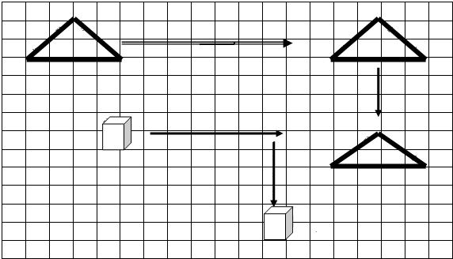

# Mathematics (Grade 3)

**ID**: 004ceaa7
**难度**: hard
**题型**: fill_in_the_blank

## 题目
看图填一填

（1）三角形先向$\underline{\hspace{5em}}$平移了$\underline{\hspace{5em}}$格，再向$\underline{\hspace{5em}}$平移$\underline{\hspace{5em}}$格．
（2）正方体先向$\underline{\hspace{5em}}$平移了$\underline{\hspace{5em}}$格再向$\underline{\hspace{5em}}$平移$\underline{\hspace{5em}}$格．

## 解答

**答案**: 右, 13, 下, 6, 右, 6, 下, 5

1. Step1:观察图中三角形的箭头方向和对应点位置，发现其先沿水平方向向右移动，通过数格子得出移动了13格
2. Step2:继续观察三角形，发现其接着沿垂直方向向下移动，数格子可知移动了6格
3. Step3:观察图中正方体的箭头方向和对应点位置，发现其先沿水平方向向右移动，数格子得出移动了6格
4. Step4:再观察正方体，发现其接着沿垂直方向向下移动，数格子可知移动了5格

## 知识点

**知识点**:
  - 平移．

---
