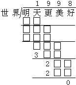

# Mathematics (Grade 3)

**ID**: 00bde9ce
**难度**: hard
**题型**: fill_in_the_blank

## 题目
如图的除法中，不同的汉字代表不同数字．问“明天更美好”代表的五位数是$\underline{\hspace{5em}}$．

## 解答

**答案**: 71928

1. Step1:由8同'世界'的乘积是2百几十几，得出'世界'这个数应是大于25小于38的数
2. Step2:由9同'世界'的乘积是3百几十几，得出'世界'是大于33的数
3. Step3:综合以上两个条件，确定'世界'大于33小于38，可能是34，35，36，37
4. Step4:当'世界'是34时，计算1998×34=67932，发现'美'同'世'数字一样，不合题意
5. Step5:当'世界'是35时，计算1998×35=69930，发现'美'同'世'数字一样，'天'和'明'数字一样，不合题意
6. Step6:当'世界'是36时，计算1998×36=71928，发现每个字代表的数字不同，合题意
7. Step7:当'世界'是37时，计算1998×37=73926，发现'天'同'世'数字一样，'界'和'明'一样，不合题意
8. Step8:综上，确定'明天更美好'是71928

## 知识点

**知识点**:
  - 竖式数字谜．

---
