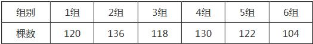

# Mathematics (Grade 3)

**ID**: 07e26c84
**难度**: hard
**题型**: fill_in_the_blank

## 题目
统计填空
下面是三（1）班6个小组参加植树的情况统计图．

（1）三（1）班6个小组共植树$\underline{\hspace{5em}}$棵．
（2）植树最多的组和植树最少的组他们之间相差的棵树是$\underline{\hspace{5em}}$棵．
（3）你还能获得哪些信息？

## 解答

**答案**: 720, 32

1. Step1:计算三（1）班6个小组共植树的棵数，将120、136、118、130、122、104这六个数相加，即120+136+118+130+122+104=720棵
2. Step2:找出植树最多的组是2组，植树136棵，植树最少的组是6组，植树104棵，计算它们相差的棵数，136 - 104 = 32棵

## 知识点

**知识点**:
  - 从统计图表中获取信息．

---
