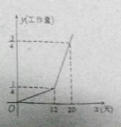

# Mathematics (Grade 3)

**ID**: 0b5a69b9
**难度**: hard
**题型**: fill_in_the_blank

## 题目
甲，乙两个工程队共同完成一项工程，先由甲单独做，然后乙队加入两个工程队合做完成余下工程，工程的进度y与甲工作的时间x（天）的函数关系如图所示，则乙单独完成此项工程需______天。

$\frac{3}{4}\,\,\frac{1}{4}\,\,O\,\,12\,\,20\,$
 y（工作量）
 x（天）

## 解答

**答案**: 24

1. Step1:由图可知甲单独做12天完成了工程的$rac{1}{4}$，根据工作效率 = 工作量÷工作时间，可得甲的工作效率为$rac{1}{4}÷12=rac{1}{48}$
2. Step2:从图中可知甲乙合作完成的工作量是$rac{3}{4}-rac{1}{4}=rac{1}{2}$，合作时间是20 - 12 = 8天，根据工作效率 = 工作量÷工作时间，可得甲乙合作的工作效率为$(rac{3}{4}−rac{1}{4})÷(20−12)=rac{1}{16}$
3. Step3:因为乙的工作效率 = 甲乙合作的工作效率 - 甲的工作效率，所以乙的工作效率为$rac{1}{16}−rac{1}{48}=rac{1}{24}$
4. Step4:根据工作时间 = 工作量÷工作效率，工作总量看作1，所以乙单独完成此项工程需要的时间为$1÷rac{1}{24}=24$天

## 知识点

**知识点**:
  - 

---
