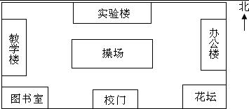

# Mathematics (Grade 3)

**ID**: 0b7a9f29
**难度**: hard
**题型**: fill_in_the_blank

## 题目
如图是红星小学的校园平面图．

（1）教学楼在操场的 $\underline{\hspace{5em}}$ 面，实验楼在操场的 $\underline{\hspace{5em}}$ 面，校门在操场的 $\underline{\hspace{5em}}$ 面，办公楼在操场的 $\underline{\hspace{5em}}$ 面．
（2）花坛在操场的 $\underline{\hspace{5em}}$ 面，图书室在操场的 $\underline{\hspace{5em}}$ 面．

## 解答

**答案**: 西, 北, 南, 东, 东南, 西南

1. Step1:根据地图上“上北下南，左西右东”的方向辨别方法，观察图中教学楼在操场的左边，所以教学楼在操场的西面
2. Step2:观察图中实验楼在操场的上方，所以实验楼在操场的北面
3. Step3:观察图中校门在操场的下方，所以校门在操场的南面
4. Step4:观察图中办公楼在操场的右边，所以办公楼在操场的东面
5. Step5:观察图中花坛在操场的右下方，右下方是东南方向，所以花坛在操场的东南面
6. Step6:观察图中图书室在操场的左下方，左下方是西南方向，所以图书室在操场的西南面

## 知识点

**知识点**:
  - 方向

---
