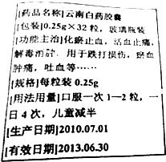

# Mathematics (Grade 3)

**ID**: 0b98a5df
**难度**: hard
**题型**: fill_in_the_blank

## 题目
如图是一种药品的说明书，仔细阅读，解决问题
①这种药的名称是 $\underline{\hspace{5em}}$ 
②成人一天最多服 $\underline{\hspace{5em}}$ 粒，合 $\underline{\hspace{5em}}$ g
③这种药有效期是 $\underline{\hspace{5em}}$ 年，1瓶最多吃 $\underline{\hspace{5em}}$ 天．
④这种药主要用于 $\underline{\hspace{5em}}$ 等．

## 解答

**答案**: 云南白药胶囊, 8, 2, 3, 4, 跌打损伤、淤血肿痛、吐血等

1. Step1:从说明书中找到药品名称，得出这种药的名称是云南白药胶囊
2. Step2:根据说明书中成人的用法用量，计算出一天最多服2×4=8粒，再通过每粒0.25g算出8粒合0.25×8=2g
3. Step3:由说明书中的生产日期和有效期，计算有效期为2013.06.30 - 2010.07.01 = 3年，再根据一瓶32粒和成人一天最多服8粒，算出1瓶最多吃32÷8=4天
4. Step4:从说明书的功能主治中获取这种药主要用于跌打损伤、淤血肿痛、吐血等

## 知识点

**知识点**:
  - 图文应用题

---
