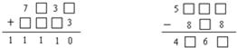

# Mathematics (Grade 3)

**ID**: 132b14e3
**难度**: hard
**题型**: fill_in_the_blank

## 题目
在下面的□里填上适当的数．

## 解答

**答案**: 7837, 3273, 11110, 5088, 828, 4260

1. Step1:分析加法竖式个位，因为□+3=10，所以个位的□填7，向十位进一
2. Step2:分析加法竖式十位，3+1+□=11，所以十位的□填7，向百位进一
3. Step3:分析加法竖式百位，□+□+1=11，即这两个数相加等于10，向千位进一
4. Step4:分析加法竖式千位，7+□+1=11，所以千位的□填3，得到加法竖式为7837 + 3273 = 11110
5. Step5:分析减法竖式，根据被减数最高位是5，差的最高位是4，可知被减数百位上的数减8不够减，要向上一位借一当十
6. Step6:确定减法竖式个位，8 - 8 = 0
7. Step7:确定减法竖式十位，8 - 2 = 6
8. Step8:确定减法竖式百位，因为百位不够减，所以被减数百位为0，得到减法竖式为5088 - 828 = 4260

## 知识点

**知识点**:
  - 竖式数字谜．

---
