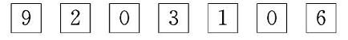

# Mathematics (Grade 3)

**ID**: 150a57df
**难度**: hard
**题型**: fill_in_the_blank

## 题目
按要求写数。

1.组成最大的七位数： $\underline{\hspace{5em}}$ 
2.组成最小的七位数： $\underline{\hspace{5em}}$ 
3.只读一个“零”的七位数： $\underline{\hspace{5em}}$ 
4.两个“零”都读的七位数： $\underline{\hspace{5em}}$ 
5.一个“零”也不读的七位数： $\underline{\hspace{5em}}$ 
6.近似数是220万的最大的数： $\underline{\hspace{5em}}$

## 解答

**答案**: 9632100, 1002369, 9203106, 9023106, 9231600, 2196300

1. Step1:将数字9、2、0、3、1、0、6从大到小排列，得到最大的七位数9632100
2. Step2:将1写在最高位，然后把剩下的0、2、3、6、9按从小到大排列，得到最小的七位数1002369
3. Step3:依据有一个0或连续几个0不能写在每级的末尾可只读一个零的规则，写出9203106（答案不唯一）
4. Step4:按照把两个0分成两组且每个0都不能写在每级的末尾的要求，写出9023106（答案不唯一）
5. Step5:根据把所有的0都写在每级的末尾就一个零也不读的规则，写出9231600（答案不唯一）
6. Step6:因为近似数220万是千位上的数向前进一得到的，所以百万位是2，十万位是1，万位是9，再将剩下的6、3、0按从大到小排列，得到2196300

## 知识点

**知识点**:
  - 整数的认识;整数的读法和写法

---
