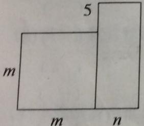

# Mathematics (Grade 3)

**ID**: 1551b89b
**难度**: hard
**题型**: fill_in_the_blank

## 题目

 (1)正方形的面积＝______；
 (2)长方形的面积＝______；
 (3)正方形和长方形面积的和＝______．

## 解答

**答案**: m^2, mn+5n, m^2+mn+5n

1. Step1:根据正方形面积公式（正方形面积=边长×边长），已知正方形边长为m，所以其面积为m×m=m**2
2. Step2:根据长方形面积公式（长方形面积=长×宽），长方形长为m + 5，宽为n，所以其面积为(m + 5)×n=mn + 5n
3. Step3:求正方形和长方形面积的和，将前面求得的正方形面积m**2与长方形面积mn + 5n相加，得到m**2+mn + 5n

## 知识点

**知识点**:
  - --

---
