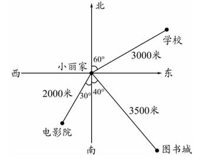

# Mathematics (Grade 3)

**ID**: 17372283
**难度**: hard
**题型**: fill_in_the_blank

## 题目
以小丽家为观测点，说说学校、电影院、图书城的位置。

1.学校的位置是（）偏（）（），距离小丽家（）。
2.电影院的位置是（）偏（）（），距离小丽家（）。
3.图书城的位置是（）偏（）（），距离小丽家（）。

## 解答

**答案**: 北, 东, 60°, 3000米, 南, 西, 30°, 2000米, 南, 东, 40°, 3500米

1. Step1:根据'上北下南左西右东'，观察图形可知学校在小丽家上方偏右，与纵轴夹角为60°，所以学校位置是北偏东60°，距离是3000米
2. Step2:同样根据'上北下南左西右东'，电影院在小丽家下方偏左，与纵轴夹角为30°，所以电影院位置是南偏西30°，距离是2000米
3. Step3:依据'上北下南左西右东'，图书城在小丽家下方偏右，与纵轴夹角为40°，所以图书城位置是南偏东40°，距离是3500米

## 知识点

**知识点**:
  - 根据方向和距离确定位置

---
