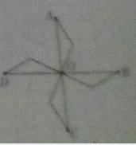

# Mathematics (Grade 3)

**ID**: 186b1cea
**难度**: hard
**题型**: fill_in_the_blank

## 题目
（1）下图按顺时针方向旋转，当A点转到B点的位置时，C点绕着（    ）点旋转（    ）°到达（    ）点的位置。
 （2）如果按逆时针方向旋转，当A点转到D点的位置时，C点绕着（    ）点旋转（    ）°到达（    ）点的位置。
 （3）如果按逆时针方向旋转，当B点转到D点的位置时，C点绕着（    ）点旋转（    ）°到达（    ）点的位置。

## 解答

**答案**: O, 90, D, O, 90, B, O, 180, A

1. Step1:分析顺时针旋转情况，当A点转到B点的位置时，根据图形旋转的性质，可知旋转中心是O点，A点到B点是旋转了90°，所以C点绕着O点旋转90°到达D点的位置，得出第一个空为O，第二个空为90，第三个空为D
2. Step2:分析逆时针旋转情况，当A点转到D点的位置时，旋转中心是O点，A点到D点是旋转了90°，所以C点绕着O点旋转90°到达B点的位置，得出第四个空为O，第五个空为90，第六个空为B
3. Step3:分析逆时针旋转情况，当B点转到D点的位置时，旋转中心是O点，B点到D点是旋转了180°，所以C点绕着O点旋转180°到达A点的位置，得出第七个空为O，第八个空为180，第九个空为A

## 知识点

**知识点**:
  - --

---
