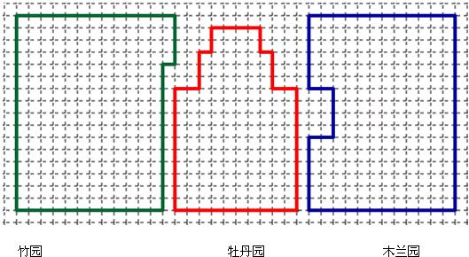

# Mathematics (Grade 3)

**ID**: 18993a78
**难度**: hard
**题型**: fill_in_the_blank

## 题目
下面各园区的周长分别是多少米？（每个正方形边长是1m）

（1）竹园周长：$\underline{\hspace{5em}}$
（2）牡丹园周长：$\underline{\hspace{5em}}$
（3）木兰园周长：$\underline{\hspace{5em}}$．

## 解答

**答案**: 58米, 50米, 60米

1. Step1:计算竹园周长，竹园可看作长16米、宽13米的长方形，根据长方形周长公式（长+宽）×2，可得(16 + 13)×2 = 29×2 = 58米
2. Step2:计算牡丹园周长，牡丹园可看作长15米、宽10米的长方形，根据长方形周长公式（长+宽）×2，可得(15 + 10)×2 = 25×2 = 50米
3. Step3:计算木兰园周长，木兰园可看作长16米、宽12米的长方形，其周长为(16 + 12)×2 = 28×2 = 56米，再加上额外2条2米的线段长度，即56 + 2×2 = 56 + 4 = 60米

## 知识点

**知识点**:
  - 长方形的周长．

---
