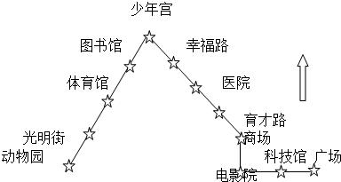

# Mathematics (Grade 3)

**ID**: 242fe77c
**难度**: hard
**题型**: fill_in_the_blank

## 题目
说一说：
1路车的行车路线．从广场出发向$\underline{\hspace{5em}}$行驶$\underline{\hspace{5em}}$站到电影院，再向$\underline{\hspace{5em}}$行驶$\underline{\hspace{5em}}$站到商场，再向$\underline{\hspace{5em}}$偏$\underline{\hspace{5em}}$的方向行驶$\underline{\hspace{5em}}$站到少年宫，再向$\underline{\hspace{5em}}$偏$\underline{\hspace{5em}}$的方向行驶$\underline{\hspace{5em}}$站到动物园．
（1）小明从商场出发坐了4站，他可能在哪站下车？写出行车路线．
（2）小红坐了3站在少年宫下车，她是从哪站上车的？写出行车路线．

## 解答

**答案**: 西, 2, 北, 1, 西, 北, 4, 西, 南, 4

1. Step1:根据地图方向辨别方法'上北下南，左西右东'，观察地图可知从广场出发向左即向西行驶，数广场到电影院之间的站点数为2站，所以从广场出发向西行驶2站到电影院
2. Step2:从电影院出发向上即向北行驶，数电影院到商场之间的站点数为1站，所以再向北行驶1站到商场
3. Step3:从商场到少年宫，方向是左偏上即西偏北，数商场到少年宫之间的站点数为4站，所以再向西偏北的方向行驶4站到少年宫
4. Step4:从少年宫到动物园，方向是左偏下即西偏南，数少年宫到动物园之间的站点数为4站，所以再向西偏南的方向行驶4站到动物园

## 知识点

**知识点**:
  - 路线图．

---
