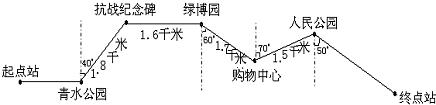

# Mathematics (Grade 3)

**ID**: 2661ca4a
**难度**: hard
**题型**: fill_in_the_blank

## 题目
如图是某市一公交车行驶的线路图，请根据线路图填空．

（1）若公交车从起点站出发，向$\underline{\hspace{5em}}$行驶到达青水公园，再向$\underline{\hspace{5em}}$偏$\underline{\hspace{5em}}$的方向行$\underline{\hspace{5em}}$千米到达抗战纪念碑．
（2）若李老师从购物中心上车，将沿$\underline{\hspace{5em}}$偏$\underline{\hspace{5em}}$的方向到达人民公园，若公交车每小时行30公里，则需$\underline{\hspace{5em}}$分钟就可到达人民公园．

## 解答

**答案**: 东, 北, 东40°, 1.8, 北, 东70°, 3

1. Step1:根据图中方向规则上北下南，左西右东，可知公交车从起点站出发到青水公园是向东行驶
2. Step2:观察线路图，从青水公园到抗战纪念碑是向北偏东40°的方向，距离为1.8千米
3. Step3:从购物中心到人民公园，根据图中方向可知是沿北偏东70°的方向
4. Step4:已知公交车速度每小时行30公里，即30千米/小时，从购物中心到人民公园距离为1.5千米，根据时间=路程÷速度，先算出时间为1.5÷30小时，再将小时换算为分钟，1小时=60分钟，所以时间为1.5÷30×60 = 3分钟

## 知识点

**知识点**:
  - 路线图．

---
