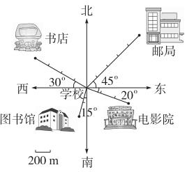

# Mathematics (Grade 3)

**ID**: 2d661320
**难度**: hard
**题型**: fill_in_the_blank

## 题目
以学校为观测点。

（1）邮局在学校东偏（）（）的方向上，距离为（）m。
（2）书店在学校（）偏（）（）的方向上，距离为（）m。
（3）图书馆在学校（）偏（）（）的方向上，距离为（）m。
（4）电影院在学校东偏（）（）的方向上，距离为（）m。

## 解答

**答案**: 北, 45°, 1000, 西, 北, 30°, 800, 南, 西, 15°, 400, 南, 20°, 600

1. Step1:观察邮局位置，其在学校东偏北方向，角度为45°，数出邮局到学校的格数为5，根据一个格200米，计算距离为5×200=1000米，得到邮局答案为北、45°、1000
2. Step2:观察书店位置，其在学校西偏北方向，角度为30°，数出书店到学校的格数为4，计算距离为4×200=800米，得到书店答案为西、北、30°、800
3. Step3:观察图书馆位置，其在学校南偏西方向，角度为15°，数出图书馆到学校的格数为2，计算距离为2×200=400米，得到图书馆答案为南、西、15°、400
4. Step4:观察电影院位置，其在学校东偏南方向，角度为20°，数出电影院到学校的格数为3，计算距离为3×200=600米，得到电影院答案为南、20°、600

## 知识点

**知识点**:
  - 根据方向和距离确定位置

---
