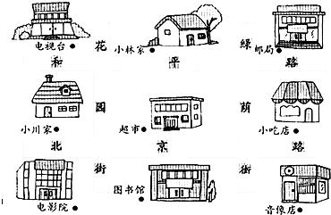

# Mathematics (Grade 3)

**ID**: 2d69e449
**难度**: hard
**题型**: fill_in_the_blank

## 题目
看图做题．

(1)花园街的西面有______、______、______．
(2)图书馆在小林家的______面，小川家在小林家的______面，也就是在电视台的______面．超市的西北面是______．
(3)请你说一说小川去邮局，可以怎么走：先向______走，再向______走，最后向______方走到邮局．

## 解答

**答案**: 电视台, 小川家, 电影院, 南, 西南, 南, 电视台, 东, 东, 北

1. Step1:根据地图方向‘上北下南，左西右东’，花园街的西面即左边，观察图可知有电视台、小川家、电影院，得到(1)的答案
2. Step2:观察图，以小林家为中心，图书馆在小林家下方即南面；小川家在小林家左下角即西南面，小川家在电视台下方即南面；以超市为中心，超市的西北面即左上角是电视台，得到(2)的答案
3. Step3:从小川家出发去邮局，观察路线，先向右即向东走，再继续向右即向东走，最后向上即向北方走到邮局，得到(3)的答案

## 知识点

**知识点**:
  - 方向;路线图．

---
