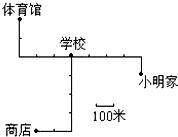

# Mathematics (Grade 3)

**ID**: 3a265491
**难度**: hard
**题型**: fill_in_the_blank

## 题目
（1）小明从家向$\underline{\hspace{5em}}$走$\underline{\hspace{5em}}$米，再向$\underline{\hspace{5em}}$走$\underline{\hspace{5em}}$米到学校．
（2）小明从学校向$\underline{\hspace{5em}}$走$\underline{\hspace{5em}}$米，再向$\underline{\hspace{5em}}$走$\underline{\hspace{5em}}$米到体育馆．

## 解答

**答案**: 北, 100, 西, 400, 西, 300, 北, 200

1. Step1:根据地图方向规定“上北下南、左西右东”以及图上距离和实际距离的关系（图上距离1厘米表示实际距离100米），观察小明家到学校的路线，先向上即向北走，图上距离为1厘米，所以实际走1×100 = 100米
2. Step2:接着从小明家向北走后的位置再向左即向西走，图上距离为4厘米，所以实际走4×100 = 400米到达学校
3. Step3:再看学校到体育馆的路线，先向左即向西走，图上距离为3厘米，所以实际走3×100 = 300米
4. Step4:然后从学校向西走后的位置再向上即向北走，图上距离为2厘米，所以实际走2×100 = 200米到达体育馆

## 知识点

**知识点**:
  - 路线图．

---
