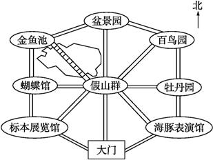

# Mathematics (Grade 3)

**ID**: 3b014012
**难度**: hard
**题型**: fill_in_the_blank

## 题目
绿地公园导游图

（1）金鱼池在假山群的（______）方向，在盆景园的（______）方向，在蝴蝶馆的（______）面。
（2）假山群的东北方向是（______），东南方向是（______），西北方向是（______），西南方向是（______）。
（3）大门在牡丹园的（______）方向，牡丹园在大门的（______）方向。
（4）盆景园在蝴蝶馆的（______）方向，在牡丹园的（______）方向。蝴蝶馆在盆景园的（______）方向，在大门的（______）方向。

## 解答

**答案**: 西北, 西南, 北, 百鸟园, 海豚表演馆, 金鱼池, 标本展览馆, 西南, 东北, 东北, 西北, 西南, 西北

1. Step1:根据地图方向辨别方法“上北下南，左西右东”，观察金鱼池与假山群的位置关系，可得金鱼池在假山群的西北方向
2. Step2:观察金鱼池与盆景园的位置关系，可知金鱼池在盆景园的西南方向
3. Step3:观察金鱼池与蝴蝶馆的位置关系，得出金鱼池在蝴蝶馆的北面
4. Step4:观察假山群的东北方向，确定是百鸟园
5. Step5:观察假山群的东南方向，确定是海豚表演馆
6. Step6:观察假山群的西北方向，确定是金鱼池
7. Step7:观察假山群的西南方向，确定是标本展览馆
8. Step8:观察大门与牡丹园的位置关系，得出大门在牡丹园的西南方向
9. Step9:观察牡丹园与大门的位置关系，得出牡丹园在大门的东北方向
10. Step10:观察盆景园与蝴蝶馆的位置关系，得出盆景园在蝴蝶馆的东北方向
11. Step11:观察盆景园与牡丹园的位置关系，得出盆景园在牡丹园的西北方向
12. Step12:观察蝴蝶馆与盆景园的位置关系，得出蝴蝶馆在盆景园的西南方向
13. Step13:观察蝴蝶馆与大门的位置关系，得出蝴蝶馆在大门的西北方向

## 知识点

**知识点**:
  - 小学数学;图形与几何;位置与方向;方向

---
