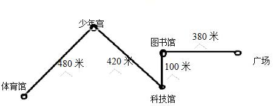

# Mathematics (Grade 3)

**ID**: 4559f383
**难度**: hard
**题型**: fill_in_the_blank

## 题目
我知道

（1）从广场出发向西行驶380米到图书馆，再向 $\underline{\hspace{5em}}$ 行驶 $\underline{\hspace{5em}}$ 米到科技馆，再向 $\underline{\hspace{5em}}$ 行驶 $\underline{\hspace{5em}}$ 米到少年宫，再向 $\underline{\hspace{5em}}$ 行驶 $\underline{\hspace{5em}}$ 米到体育馆．
（2）小明从体育馆出发到科技馆，请你写出小明的行走路线．

## 解答

**答案**: 南, 100, 西北, 420, 西南, 480

1. Step1:根据上北下南，左西右东的方位辨别法，从图书馆到科技馆是向下的方向，即南方，距离为100米
2. Step2:从科技馆到少年宫是向左上方的方向，即西北方向，距离为420米
3. Step3:从少年宫到体育馆是向左下方的方向，即西南方向，距离为480米

## 知识点

**知识点**:
  - 路线图

---
