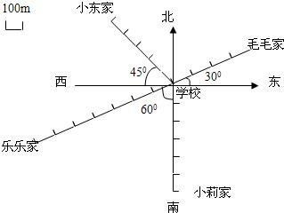

# Mathematics (Grade 3)

**ID**: 4b1c044f
**难度**: hard
**题型**: fill_in_the_blank

## 题目
（1）学校在小莉$\underline{\hspace{5em}}$方向上，距离是$\underline{\hspace{5em}}$米．
（2）乐乐家在学校的$\underline{\hspace{5em}}$方向上，距离是$\underline{\hspace{5em}}$米．
（3）小东家在学校的$\underline{\hspace{5em}}$方向上，距离是$\underline{\hspace{5em}}$米．
（4）毛毛家在学校的$\underline{\hspace{5em}}$方向上，距离是$\underline{\hspace{5em}}$米．

## 解答

**答案**: 正北, 600, 南偏西60°, 700, 西偏北45°, 500, 东偏北30°, 400

1. Step1:根据图意和已知条件，确定图上距离1厘米代表实际距离100米
2. Step2:观察学校与小莉家的位置关系，得出学校在小莉正北方向，数出图上距离为6厘米，计算实际距离为6×100 = 600米
3. Step3:观察乐乐家与学校的位置关系，得出乐乐家在学校南偏西60°方向，数出图上距离为7厘米，计算实际距离为7×100 = 700米
4. Step4:观察小东家与学校的位置关系，得出小东家在学校西偏北45°方向，数出图上距离为5厘米，计算实际距离为5×100 = 500米
5. Step5:观察毛毛家与学校的位置关系，得出毛毛家在学校东偏北30°方向，数出图上距离为4厘米，计算实际距离为4×100 = 400米

## 知识点

**知识点**:
  - 根据方向和距离确定物体的位置．

---
