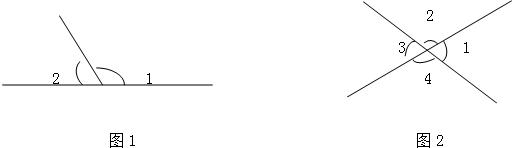

# Mathematics (Grade 3)

**ID**: 4e52f4cc
**难度**: hard
**题型**: fill_in_the_blank

## 题目
算一算．

（1）如图1，已知：∠2=65°，∠1=$\underline{\hspace{5em}}$      
（2）如图2，已知：∠1=55°，∠2=$\underline{\hspace{5em}}$      ，∠3=$\underline{\hspace{5em}}$      ，∠4=$\underline{\hspace{5em}}$      ．

## 解答

**答案**: 115°, 125°, 55°, 125°

1. Step1:对于图1，因为平角为180°，所以求∠1用180°减去∠2，即∠1=180° - 65°
2. Step2:计算180° - 65°，得出∠1=115°
3. Step3:对于图2，由于平角是180°，求∠2用180°减去∠1，即∠2=180° - 55°
4. Step4:计算180° - 55°，得出∠2=125°
5. Step5:求∠3用180°减去∠2，即∠3=180° - 125°
6. Step6:计算180° - 125°，得出∠3=55°
7. Step7:求∠4用180°减去∠3，即∠4=180° - 55°
8. Step8:计算180° - 55°，得出∠4=125°

## 知识点

**知识点**:
  - 角的概念及其分类

---
